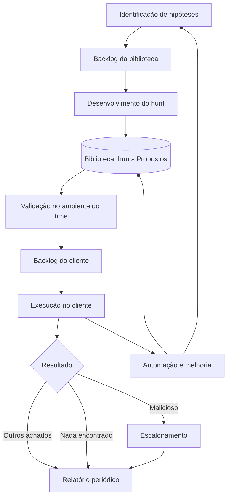

# 01 — Processo

Define **como** os hunts são identificados, desenvolvidos, priorizados, executados, escalados e melhorados.

## Dois processos distintos

| Processo | O que é | Frequência | Resultado |
|----------|---------|------------|-----------|
| **Desenvolvimento** | Criar um hunt novo, publicá-lo na biblioteca como Proposto e validá-lo no ambiente do time até ficar Ativo | Uma vez por hunt (e nas revisões) | Hunt reutilizável, sem dados de clientes |
| **Execução** | Aplicar um hunt Ativo no ambiente do time em um cliente específico | Recorrente, em cada ciclo e em cada cliente | Achados, registro de execução e relatório |

Desenvolvimento é investimento na biblioteca. Execução é a entrega recorrente ao cliente.

## Ciclo completo

## Documentos

Ordem de leitura recomendada:

| # | Documento | Conteúdo |
|---|-----------|----------|
| 1 | [Identificação de hunts](identificacao-de-hunts.md) | Fontes de hipóteses, gatilhos e avaliação de ameaças por cliente |
| 2 | [Desenvolvimento de hunts](desenvolvimento-de-hunts.md) | Do objetivo à publicação na biblioteca e à validação no ambiente do time |
| 3 | [Backlog e priorização](backlog-e-priorizacao.md) | Os dois backlogs, pontuação de prioridade e cadência por nível |
| 4 | [Execução de hunts](execucao-de-hunts.md) | Ciclo mensal por cliente e registro de execução |
| 5 | [Escalonamento](escalonamento.md) | Severidade, fluxos por modo de resposta e notificação |
| 6 | [Automação e melhoria](automacao-e-melhoria.md) | "Hunt once", lições aprendidas e revisão dos hunts |

## Leitura complementar

O OTHF também apresenta o processo **TaHiTI** (Targeted Hunting integrating Threat Intelligence), uma metodologia aberta. Este projeto segue o processo do próprio OTHF, que é o que o [template de hunt](../02-templates/template-hunt.md) espelha, e recomenda o TaHiTI apenas como leitura complementar, para não manter dois métodos em paralelo.

## Origem no OTHF

Módulo 6 (Operational).
