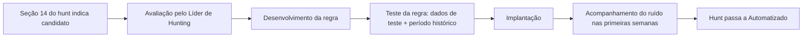

# Automação e melhoria

Um hunt não termina na execução. Ele pode virar uma detecção contínua e sempre deve gerar aprendizado para o próximo ciclo.

## 1. "Hunt once"

O OTHF propõe a abordagem **"hunt once"**: um padrão encontrado manualmente não deveria depender de uma nova execução manual para ser detectado de novo. Quando possível, o hunt é convertido em regra de detecção contínua, e o tempo do time é liberado para novas hipóteses.

### O que humanos e máquinas fazem melhor

| Humanos | Máquinas |
|---------|----------|
| Lidar com incerteza e ambiguidade | Executar o mesmo processo de forma consistente |
| Reconhecer padrões novos | Escalar rapidamente para muitos dados e clientes |
| Tomar decisões e julgar quando o contexto muda | Processar condições complexas sem erro |

O hunting fica com o que é ambíguo e novo; a detecção fica com o que já é conhecido e repetível.

### Critérios para converter um hunt em detecção

Um hunt é bom candidato à automação quando atende à maioria dos critérios:

| Critério | Pergunta |
|----------|----------|
| **Ruído baixo** | Os resultados maliciosos podem ser separados dos benignos sem análise humana extensa? |
| **Lógica estável** | A lógica não depende de julgamento que muda a cada cliente ou execução? |
| **Repetição** | O hunt é executado com frequência ou em muitos clientes? |
| **Volume** | O volume de dados é grande demais para análise manual eficiente? |
| **Propensão a erro** | A análise manual é complexa e sujeita a erro humano? |
| **Suporte da plataforma** | A plataforma permite implementar a lógica como regra? |

Hunts baseados em stacking ou em comparação com baseline costumam **não** ser bons candidatos, porque dependem de julgamento sobre o que é raro em cada ambiente. Nesses casos, a automação pode ser **parcial**: uma regra que gera um alerta de baixa prioridade para revisão humana.

### Fluxo de conversão

- Quem implementa a regra depende do nível contratado e do acesso às plataformas (ver [RACI](../00-servico/papeis-e-responsabilidades.md#3-matriz-raci--soc--cliente)).
- A regra criada é registrada na seção 14 do hunt.
- No ambiente do time, o hunt passa ao status operacional **Automatizado**. Na biblioteca, ele continua publicado: ele documenta a lógica da regra e pode ser executado manualmente se a regra for desativada ou se o cliente não tiver a plataforma que a suporta.
- Regras derivadas de hunts devem ser revisadas quando o hunt de origem for revisado.

## 2. Lições aprendidas

Ao final de **cada execução**, o analista registra as lições aprendidas no registro de execução. Ao final de **cada ciclo**, o Líder de Hunting consolida as lições do ciclo. As perguntas cobrem pessoas, processo e tecnologia:

| Área | Perguntas |
|------|-----------|
| **Objetivo** | O objetivo do hunt foi atingido? A hipótese foi testada de fato? |
| **Inteligência** | A inteligência que originou o hunt era relevante e precisa? |
| **Dados** | As fontes estavam disponíveis e confiáveis? Faltou algum campo ou retenção? |
| **Hunt** | As consultas funcionaram? Houve falsos positivos novos? A triagem foi clara? |
| **Processo** | O fluxo foi seguido? Alguma etapa atrapalhou ou faltou? |
| **Pessoas** | O analista tinha as competências necessárias? Faltou apoio? |
| **Tempo** | O esforço real foi próximo do estimado? |

Cada lição gera uma ação: revisão do hunt, ajuste no processo, treinamento, recomendação ao cliente ou atualização do esforço estimado.

## 3. Melhoria contínua do serviço

Seguindo o modelo de melhoria contínua citado pelo OTHF (baseado no ITIL), a revisão periódica do serviço percorre sete etapas:

| Etapa | Aplicação no serviço |
|----------|----------------------|
| **Qual é a visão?** | A missão e as metas do serviço continuam válidas? (ver [definição](../00-servico/definicao-e-missao.md)) |
| **Onde estamos agora?** | O que as métricas e as lições aprendidas mostram? |
| **Onde queremos chegar?** | Quais objetivos definir para o próximo período? (ver [GOST](../00-servico/objetivos-e-capacidade.md)) |
| **Como chegamos lá?** | Quais ações (novos hunts, treinamentos, ajustes de processo) planejar? |
| **Agir** | Executar as ações planejadas, com responsáveis e prazos. |
| **Chegamos lá?** | As métricas mostram que os objetivos foram atingidos? |
| **Como manter o ritmo?** | O que fazer para que as melhorias se mantenham? |

Referência de periodicidade:

| Atividade | Frequência |
|-----------|------------|
| Lições aprendidas da execução | A cada execução |
| Consolidação das lições | A cada ciclo |
| Revisão do backlog da biblioteca | A cada ciclo |
| Revisão de cada hunt ativo | Pelo menos anual |
| Revisão do serviço (metas, processo, ofertas) | Pelo menos anual |

---

Baseado em: OTHF, módulo 6 — Operational (Automation e Continuous Improvement). Licença MIT, ver [`referencias/OTHF/`](../referencias/OTHF/).
