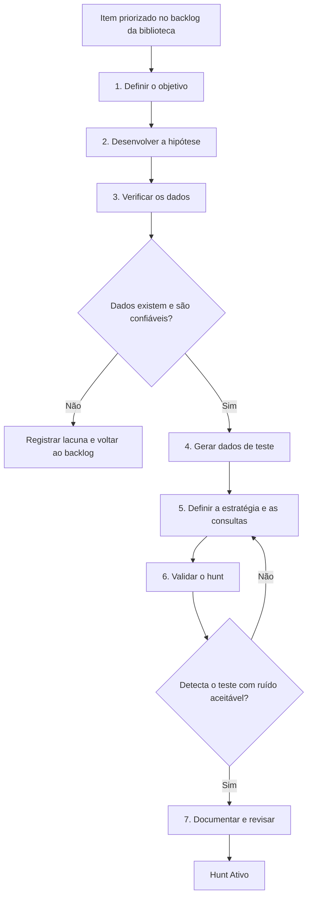

# Desenvolvimento de hunts

Processo para criar um hunt novo e levá-lo de **Rascunho** a **Ativo**. Cada etapa preenche uma ou mais seções do [template de hunt](../02-templates/template-hunt.md).

> **Biblioteca pública × ambiente do time.** Neste repositório, os hunts são publicados como **Proposto** depois das etapas 1, 2, 3, 5 e 7, sem as etapas de teste. As etapas **4 e 6** (dados de teste e validação) são executadas por **quem adota o hunt**, no próprio ambiente, antes de usá-lo em clientes (ver [ADR 0006](../decisoes/0006-validacao-pelo-adotante.md) e os [dois níveis de status](../02-templates/README.md#dois-níveis-de-status)).

Quem desenvolve: Hunter Sênior (responsável) com apoio de Hunters. Quem aprova: Líder de Hunting (ver [RACI](../00-servico/papeis-e-responsabilidades.md#3-matriz-raci--soc--cliente)).

## 1. Visão geral

| Etapa | Status | Seções do template |
|-------|--------|--------------------|
| 1 a 3 | Rascunho (biblioteca) | 1, 2, 3, 4, 5 |
| 4 a 6 | Em validação (ambiente do time) | 6, 7, 8, 9 |
| 7 | Proposto (biblioteca) · Ativo (ambiente do time, após as etapas 4 a 6) | 10 a 16 e cabeçalho |

## 2. Etapas

### Etapa 1 — Definir o objetivo

Transformar a ideia do backlog em um objetivo **SMART**:

| Critério | Pergunta | Exemplo |
|----------|----------|---------|
| **Específico** | O que exatamente queremos descobrir? | Hosts que enviaram volume anômalo de dados via DNS |
| **Mensurável** | Como saberemos que respondemos? | Lista de hosts acima do limiar, classificados |
| **Alcançável** | Temos dados e tempo para isso? | Logs de DNS disponíveis nos clientes-alvo |
| **Relevante** | Por que importa? | Técnica usada por grupos que atacam o setor |
| **Temporal** | Qual período será analisado? | Últimos 30 dias |

**Saída:** seção 1 (Objetivo) e seção 2 (Origem e contexto).

### Etapa 2 — Desenvolver a hipótese

Escrever a hipótese no formato **Dado / Quando / Então**. Uma boa hipótese:

- pode ser confirmada **ou refutada** com dados;
- descreve o que deve aparecer nos dados, não apenas o que o adversário faz;
- é específica o bastante para gerar uma consulta.

| Fraca | Forte |
|-------|-------|
| "Pode haver exfiltração na rede." | "Dado que adversários usam DNS para exfiltrar dados, quando um host codifica dados em subdomínios, então haverá consultas com subdomínios longos e de alta entropia para um mesmo domínio, em volume acima do normal do host." |

Mapear a hipótese para as técnicas MITRE ATT&CK.

**Saída:** seções 3 (Hipótese) e 4 (Mapeamento ATT&CK).

### Etapa 3 — Verificar os dados

Antes de escrever qualquer consulta, confirmar que os dados necessários existem e são confiáveis:

- **Quais fontes** registram o comportamento descrito na hipótese?
- **Quais campos** são necessários?
- **Qual retenção** mínima o hunt exige?
- **Qualidade:** os dados são completos, consistentes e atuais? Há hosts ou segmentos sem coleta?

Se nenhum cliente-alvo tem os dados necessários, o hunt não é descartado: a lacuna é registrada, o item volta ao backlog e a fonte ausente vira recomendação de visibilidade.

**Saída:** seção 5 (Fontes de dados).

### Etapa 4 — Gerar dados de teste

Reproduzir a técnica em **ambiente de laboratório** para saber exatamente como ela aparece nos dados. Opções:

- bibliotecas abertas de testes de emulação de adversário, mapeados por técnica ATT&CK;
- scripts próprios ou ferramentas usadas pelos adversários, em ambiente isolado;
- laboratórios do OTHF (ver [`referencias/OTHF/`](../referencias/OTHF/README.md#5--threat-hunting-labs)).

> **Nunca** gere dados de teste no ambiente de um cliente sem autorização formal.

**Saída:** registro do teste na seção 9 (Validação).

### Etapa 5 — Definir a estratégia e as consultas

1. **Baseline:** descrever o comportamento normal e como levantá-lo em um cliente novo.
2. **Estratégia:** escrever a lógica da busca **sem sintaxe**, indicando as técnicas de análise (stacking, enriquecimento, agrupamento, palavra-chave, IOC, análise temporal).
3. **Consultas:** implementar a estratégia em cada plataforma. Consulta não testada fica como **Não validada**.

**Saída:** seções 6 (Baseline), 7 (Estratégia) e 8 (Consultas).

### Etapa 6 — Validar o hunt

Duas validações, ambas obrigatórias:

| Validação | Pergunta | Critério de sucesso |
|-----------|----------|---------------------|
| **Com dados de teste** | O hunt encontra a técnica reproduzida na etapa 4? | Detecta o teste |
| **Histórica** | Executado em um período longo de dados reais, quanto ruído gera? | Ruído que um analista consegue triar no esforço estimado |

Se a validação falhar, voltar à etapa 5. Falsos positivos encontrados aqui vão para a seção 11.

A validação histórica pode ser feita em dados de clientes, desde que autorizada e com os resultados guardados **fora** do repositório. Na biblioteca, registra-se apenas o resumo (período, nível de ruído, data).

**Saída:** seções 8 (status das consultas) e 9 (Validação).

### Etapa 7 — Documentar e revisar

1. Completar as seções restantes: triagem (10), falsos positivos (11), ação ao encontrar (12), outros achados (13), automação (14) e referências (15).
2. Estimar o esforço por execução, no cabeçalho.
3. Abrir o pull request, conforme o [CONTRIBUTING](../CONTRIBUTING.md#7-fluxo-de-trabalho-no-git).
4. **Revisão por pares:** outro analista revisa o hunt. O revisor verifica, no mínimo:
   - se a hipótese é testável e corresponde ao objetivo;
   - se as consultas implementam a estratégia descrita;
   - se a triagem permite a um Hunter classificar os resultados sozinho;
   - se não há dados reais de clientes.
5. Aprovação do Líder de Hunting. Na biblioteca, o hunt é publicado como **Proposto**, versão **1.0**. No ambiente do time, depois das etapas 4 e 6, ele passa ao status operacional **Ativo**.

## 3. Revisão de hunts existentes

Hunts ativos são revisados:

- pelo menos uma vez por ano;
- quando uma plataforma muda (campos, sintaxe, novas fontes);
- quando a execução revela problemas (ruído, falso negativo, consulta quebrada);
- quando surge inteligência nova sobre a técnica.

A revisão segue as mesmas etapas, a partir da que for afetada, e respeita a regra de [versionamento](../02-templates/README.md#versionamento-do-hunt).

---

Baseado em: OTHF, módulo 6 — Operational (OTHF Hunting Process). Licença MIT, ver [`referencias/OTHF/`](../referencias/OTHF/).
