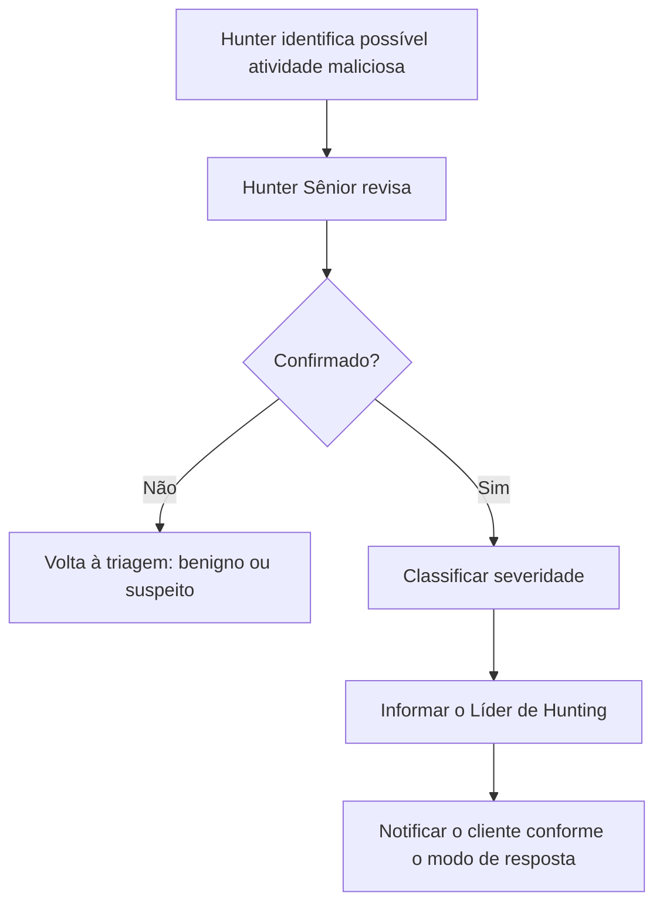
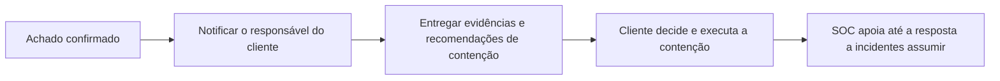
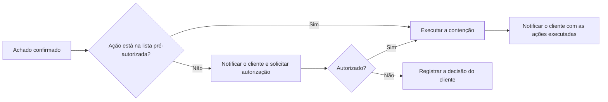

# Escalonamento

O que fazer quando um hunt encontra algo. Este processo vale para todos os níveis de oferta; o que muda é o modo de resposta contratado (ver [escopo](../00-servico/escopo.md#4-modos-de-resposta)).

## 1. Severidade dos achados

| Severidade | Critério | Exemplos | Comunicação |
|------------|----------|----------|-------------|
| **Crítica** | Atividade maliciosa confirmada **em andamento**, ou que afeta ativos críticos, contas privilegiadas ou dados sensíveis | Comunicação ativa com C2; movimentação lateral em curso; acesso de adversário a controlador de domínio | Notificação em até **2 horas** após a confirmação |
| **Alta** | Atividade maliciosa confirmada, sem indício de que esteja em andamento ou sem impacto em ativos críticos | Malware que executou e foi bloqueado posteriormente; persistência maliciosa em estação comum | Notificação em até **2 horas** após a confirmação |
| **Média** | Não é atividade maliciosa, mas é uma exposição relevante que facilita ataques | Credencial exposta em script; protocolo inseguro em ativo crítico; conta privilegiada sem uso recente e ativa | Relatório periódico (ou antes, se o analista julgar urgente) |
| **Baixa** | Problema de configuração, higiene ou visibilidade sem exposição imediata | Lacuna de logs; ativo desconhecido sem exposição; software desatualizado sem exploração conhecida | Relatório periódico |

Regras:

- Atividade **maliciosa confirmada** é sempre **Crítica** ou **Alta**.
- Na dúvida entre duas severidades, escolha a **mais alta** e registre o motivo.
- A severidade pode ser revista quando surgir informação nova, sempre com registro.

## 2. Escalonamento interno

Antes de notificar o cliente, o achado é confirmado dentro do SOC:

- O prazo de notificação conta a partir da **confirmação** pelo Hunter Sênior.
- Se o Hunter Sênior não estiver disponível, o Líder de Hunting confirma.
- Achados **Críticos** devem ser confirmados com prioridade sobre qualquer outra atividade.

## 3. Fluxos por modo de resposta

### Modo somente notificação

### Modo contenção pelo SOC

Em ambos os modos, o achado segue para o processo de **resposta a incidentes** (do cliente ou do provedor, conforme o contrato). O hunting não conduz a resposta completa (ver [exclusões](../00-servico/escopo.md#3-exclusões)).

## 4. Conteúdo mínimo da notificação

| Item | Descrição |
|------|-----------|
| **Severidade** | Crítica ou Alta, com a justificativa |
| **Resumo** | O que foi encontrado, em linguagem clara, em poucas linhas |
| **Ativos afetados** | Hosts, contas, endereços envolvidos |
| **Período** | Quando a atividade ocorreu (primeiro e último registro encontrados) |
| **Técnicas** | Técnicas MITRE ATT&CK observadas |
| **Evidências** | Principais eventos que sustentam o achado, ou a referência de onde estão |
| **Hunt de origem** | ID e versão do hunt |
| **Ações executadas** | Contenções já feitas pelo SOC, se houver |
| **Recomendações** | Ações de contenção e investigação sugeridas, em ordem de prioridade |
| **Próximos passos** | O que o SOC fará em seguida e o que se espera do cliente |
| **Contato** | Quem no SOC acompanha o caso |

Para achados **Críticos**, a notificação por escrito deve ser **acompanhada de contato direto** (telefone ou canal combinado) com o responsável do cliente.

### Cliente não alcançado

Se o responsável não for alcançado:

1. Tentar os contatos alternativos definidos no onboarding.
2. Registrar cada tentativa, com horário e canal.
3. Escalar ao Líder de Hunting, que segue as regras de escalonamento definidas no contrato.

## 5. Preservação de evidências

- Exportar os eventos que sustentam o achado assim que ele for confirmado, antes que a retenção os elimine.
- Guardar as evidências **nos sistemas de atendimento** de quem executa o serviço, com controle de acesso. Nunca neste repositório, nem em canais informais.
- Registrar quem coletou, quando e de onde (cadeia de custódia básica), pois o caso pode virar uma investigação formal.

## 6. Outros achados

Achados de severidade **Média** e **Baixa** não exigem notificação imediata, mas não podem se perder:

| Etapa | Ação |
|-------|------|
| Registro | Incluir no registro de execução, com severidade e evidência |
| Relatório | Apresentar no relatório periódico, com recomendação |
| Acompanhamento | Verificar nos ciclos seguintes se o problema foi corrigido |
| Lacunas de visibilidade | Atualizar o inventário de fontes de dados do cliente |

---

Baseado em: OTHF, módulo 6 — Operational (Document Findings), módulo 7 — Measurement e módulo 8 — Communication (comunicação com SOC/CIRT). Licença MIT, ver [`referencias/OTHF/`](../referencias/OTHF/).
