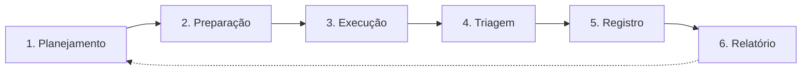

# Execução de hunts

Rotina recorrente de aplicação dos hunts Ativos em cada cliente. A execução é organizada em **ciclos mensais**.

## 1. O ciclo mensal

| Fase | Quando (referência) | Responsável | Resultado |
|------|---------------------|-------------|-----------|
| **1. Planejamento** | Primeira semana do mês | Líder de Hunting + Hunter Sênior | Plano do ciclo por cliente |
| **2. Preparação** | Antes de cada hunt | Hunter | Confirmação de que o hunt é executável |
| **3. Execução** | Ao longo do mês | Hunter | Resultados das consultas |
| **4. Triagem** | Logo após cada execução | Hunter (com apoio do Sênior) | Resultados classificados |
| **5. Registro** | Ao final de cada hunt | Hunter | Registro de execução |
| **6. Relatório** | Até 5 dias úteis após o fim do ciclo | Hunter Sênior | Relatório periódico ao cliente |

A escala e o período de cada fase são referências. O que importa é que o plano exista no início do ciclo e o relatório saia no prazo do [escopo](../00-servico/escopo.md#6-prazos-de-comunicação-de-referência).

## 2. Fases

### Fase 1 — Planejamento

Para cada cliente:

1. Revisar o backlog do cliente e recalcular as prioridades (ver [backlog e priorização](backlog-e-priorizacao.md)).
2. Selecionar os hunts do ciclo, respeitando a quantidade contratada e a capacidade do time.
3. Distribuir os hunts entre os analistas.
4. Registrar o **plano do ciclo**: hunts selecionados, responsáveis e datas previstas.

O plano é interno. Comunicar ao cliente o que será executado é opcional e depende do acordo com ele.

### Fase 2 — Preparação

Antes de executar cada hunt, o analista confirma:

- [ ] O hunt está **Ativo**, na versão mais recente.
- [ ] Existe consulta **Validada** para a plataforma do cliente.
- [ ] As fontes de dados obrigatórias continuam chegando, sem interrupções no período a analisar.
- [ ] A retenção cobre o período do hunt.
- [ ] O analista conhece o baseline do cliente para este comportamento (ou sabe como levantá-lo).
- [ ] Os falsos positivos conhecidos do cliente para este hunt foram consultados em execuções anteriores.

Se algum item falhar, ver [seção 4](#4-quando-o-hunt-não-pode-ser-executado).

### Fase 3 — Execução

1. Executar as consultas da seção 8 do hunt, ajustando apenas o período e os filtros de escopo do cliente.
2. Aplicar a estratégia da seção 7: stacking, enriquecimento, agrupamento etc.
3. Não alterar a lógica do hunt durante a execução. Se a consulta precisar de mudança, registrar no registro de execução e propor a revisão do hunt.
4. Guardar os resultados e evidências **nos sistemas de atendimento**, nunca neste repositório.

### Fase 4 — Triagem

Classificar cada resultado usando os critérios da seção 10 do hunt:

| Classificação | Ação |
|---------------|------|
| **Benigno** | Registrar o motivo. Se for recorrente, propor inclusão nos falsos positivos do hunt ou nas exceções do cliente. |
| **Suspeito** | Investigar com as perguntas de enriquecimento. Se depender do cliente, consultar o ponto focal no prazo de referência. |
| **Malicioso** | Interromper e seguir o [escalonamento](escalonamento.md). |

Resultados suspeitos não podem ficar sem conclusão. Se o ciclo terminar sem resposta do cliente, o item aparece no relatório como **pendente**, com o que falta para concluir.

### Fase 5 — Registro

Toda execução gera um **registro de execução**, que comprova o trabalho e alimenta as métricas. Campos mínimos:

| Campo | Descrição |
|-------|-----------|
| **Identificador da execução** | Código único da execução |
| **Cliente** | Identificação do cliente (no sistema de atendimento) |
| **Hunt e versão** | Ex.: `TH-EXF-001 v1.2` |
| **Analista e revisor** | Quem executou e quem revisou |
| **Data e duração** | Quando foi executado e quanto tempo levou |
| **Período analisado** | Início e fim dos dados consultados |
| **Plataforma e consultas** | Onde foi executado e se houve ajuste nas consultas |
| **Fontes de dados verificadas** | Quais fontes foram usadas e se havia lacunas |
| **Resultado** | Hipótese confirmada, refutada ou inconclusiva |
| **Achados** | Quantidade por classificação (benigno, suspeito, malicioso) e por severidade |
| **Outros achados** | Configurações incorretas, lacunas de visibilidade etc. |
| **Escalonamentos** | Referência aos chamados ou incidentes abertos |
| **Lições aprendidas** | Problemas encontrados e melhorias sugeridas ao hunt |

O modelo completo está em [`02-templates/template-registro-execucao.md`](../02-templates/template-registro-execucao.md).

### Fase 6 — Relatório

Ao fim do ciclo, o Hunter Sênior consolida os registros de execução no relatório periódico do cliente, usando o [template de relatório](../02-templates/template-relatorio-cliente.md). O Líder de Hunting revisa antes do envio. As métricas reportadas seguem o [catálogo de métricas](../02-templates/metricas.md).

## 3. Resultado de um hunt

Toda execução termina com um dos três resultados:

| Resultado | Significado |
|-----------|-------------|
| **Hipótese confirmada** | A atividade descrita na hipótese foi encontrada (maliciosa ou não). |
| **Hipótese refutada** | Os dados, com qualidade suficiente, não mostram a atividade no período analisado. |
| **Inconclusivo** | Não foi possível concluir: dados incompletos, retenção insuficiente ou pendência com o cliente. |

"Refutada" e "inconclusivo" são resultados diferentes e não devem ser confundidos no relatório. Só se pode dizer que nada foi encontrado quando os dados permitiam encontrar.

## 4. Quando o hunt não pode ser executado

| Situação | Ação |
|----------|------|
| Fonte de dados obrigatória indisponível | Registrar como lacuna de visibilidade, notificar o ponto focal se a interrupção for recente, substituir por outro hunt viável do backlog. |
| Retenção menor que o período do hunt | Executar no período disponível e marcar o resultado como **inconclusivo**, ou substituir o hunt. Registrar como lacuna. |
| Consulta quebrada (mudança na plataforma) | Não improvisar. Registrar, abrir revisão do hunt e substituir por outro hunt no ciclo. |
| Acesso à plataforma indisponível | Notificar o ponto focal. Se não for resolvido no ciclo, registrar no relatório. |

---

Baseado em: OTHF, módulo 6 — Operational (Scheduling e Document Findings) e módulo 7 — Measurement. Licença MIT, ver [`referencias/OTHF/`](../referencias/OTHF/).
