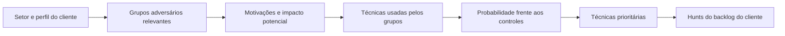

# Identificação de hunts

Todo hunt começa com uma ideia: uma suspeita, uma ameaça nova, uma técnica ainda não coberta. Este documento descreve de onde essas ideias vêm e como transformá-las em entradas do backlog.

## 1. Fontes de hipóteses

| Fonte | O que observar | Exemplo de pergunta |
|-------|----------------|---------------------|
| **Inteligência estratégica** | Grupos adversários que atacam o setor do cliente, suas motivações e campanhas recentes | "Os grupos que atacam o setor financeiro usam essa técnica de persistência. Ela está presente aqui?" |
| **Inteligência tática** | TTPs, ferramentas e indicadores publicados em relatórios, alertas de CERTs e fornecedores | "Uma campanha recente usa determinado utilitário legítimo para exfiltrar dados. Ele aparece nos nossos clientes?" |
| **Vulnerabilidades e exploits** | Vulnerabilidades exploradas ativamente, provas de conceito públicas | "Um serviço exposto do cliente é afetado por uma falha explorada ativamente. Há sinais de exploração?" |
| **Superfície de ataque** | Serviços expostos, acessos remotos, contas privilegiadas, integrações de terceiros | "Há autenticações bem-sucedidas no acesso remoto vindas de locais incomuns?" |
| **Ativos críticos** | Sistemas e dados mais valiosos para o negócio do cliente | "Quem acessou o servidor de banco de dados fora do padrão?" |
| **Observação do ambiente** | Algo estranho percebido em outro hunt, em um alerta ou em uma conversa com o cliente | "Este processo apareceu em poucos hosts. Por quê?" |
| **Incidentes anteriores** | Técnicas que já tiveram sucesso em algum cliente (sempre anonimizadas) | "A técnica usada naquele incidente deixou rastros em outros clientes?" |
| **Pentest e red team** | Caminhos que os testes mostraram ser possíveis | "O caminho usado pelo pentest para escalar privilégios foi usado por alguém além do pentester?" |
| **Novas fontes de dados** | Uma fonte recém-integrada viabiliza hunts antes impossíveis | "Agora que os logs de DNS chegam ao SIEM, o que podemos procurar?" |

## 2. Gatilhos

Além da cadência normal, os eventos abaixo devem gerar uma entrada no backlog:

| Gatilho | Ação esperada |
|---------|---------------|
| Nova campanha ou TTP relevante para o setor de um cliente | Avaliar se já existe hunt na biblioteca; se não, criar item no backlog da biblioteca |
| Vulnerabilidade crítica explorada ativamente em tecnologia usada por clientes | Avaliar **hunt extraordinário** (níveis Avançado e Estratégico) |
| Incidente em algum cliente | Após o encerramento, avaliar se a técnica justifica um hunt em todos os clientes |
| Achado de outro hunt | Registrar a nova hipótese no backlog |
| Resultado de pentest, red team ou exercício de mesa | Converter os caminhos bem-sucedidos em hipóteses |
| Mudança no ambiente do cliente (nova tecnologia, aquisição, migração para nuvem) | Revisar a avaliação de ameaças do cliente |
| Mudança regulatória | Avaliar se há novos requisitos de detecção |

## 3. Avaliação de ameaças por cliente

A avaliação de ameaças responde: **quem provavelmente atacaria este cliente, como, e quanto isso o afetaria?** Ela é feita no onboarding, revisada anualmente e sempre que o ambiente do cliente mudar. No nível Estratégico, é a base dos hunts personalizados.

### Passos

1. **Perfil do cliente.** Setor, porte, região, ativos críticos, tecnologias principais e exposição externa.
2. **Grupos adversários relevantes.** Identificar grupos e famílias de malware conhecidos por atacar o setor e a região. Fontes: [MITRE ATT&CK Groups](https://attack.mitre.org/groups/), relatórios públicos de fornecedores e CERTs, catálogos de grupos como o da ETDA (Tailândia), citado pelo OTHF.
3. **Motivações e impacto.** Para cada grupo: o que busca (dinheiro, dados, espionagem, sabotagem) e qual seria o impacto básico para o cliente. Não é uma análise de impacto completa, apenas o suficiente para priorizar.
4. **Técnicas.** Levantar as técnicas ATT&CK associadas aos grupos. O [ATT&CK Navigator](https://mitre-attack.github.io/attack-navigator/) permite sobrepor os grupos em camadas e destacar as técnicas que se repetem entre eles.
5. **Probabilidade.** Considerando os controles do cliente, avaliar a chance de cada técnica funcionar. Técnicas sem controle preventivo e sem detecção são as mais prováveis de passar despercebidas.
6. **Técnicas prioritárias.** As técnicas comuns a vários grupos relevantes, de alto impacto e sem detecção, são as primeiras candidatas a hunt.
7. **Mapeamento para a biblioteca.** Para cada técnica prioritária: existe hunt Ativo? Se sim, entra no backlog do cliente. Se não, entra no backlog da biblioteca.

### Precisão da avaliação

Em clientes novos ou com pouca informação, partes da avaliação serão baseadas em suposições. Isso é aceitável, desde que as suposições fiquem registradas. A avaliação melhora a cada ciclo, com mais conhecimento do ambiente e melhor inteligência.

### Onde guardar

A avaliação de ameaças de cada cliente contém informações sensíveis sobre ele e **não pertence a este repositório**. Ela fica nos sistemas de atendimento de quem executa o serviço (ver [ADR 0003](../decisoes/0003-sem-dados-reais-no-repositorio.md)). Avaliações **genéricas por setor**, sem dados de clientes, podem ser contribuídas ao projeto.

## 4. Da ideia ao backlog

Toda ideia, de qualquer fonte, é registrada no backlog com:

- descrição da hipótese em uma ou duas frases;
- fonte e gatilho;
- técnica(s) ATT&CK, quando já identificadas;
- se já existe hunt na biblioteca que a cubra.

A priorização acontece depois, conforme [backlog e priorização](backlog-e-priorizacao.md). Ideias não devem ser descartadas na entrada: uma técnica pouco ativa hoje pode voltar a ser usada amanhã.

---

Baseado em: OTHF, módulo 6 — Operational (Identifying Hunts, Threat Assessment e Hunt Tempo) e módulo 9 — Appendix (exemplo de avaliação de ameaças). Licença MIT, ver [`referencias/OTHF/`](../referencias/OTHF/).
