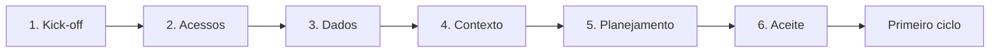

# Checklist de onboarding

Roteiro de entrada de um cliente no serviço. O onboarding termina com o **aceite formal** do cliente, e só depois dele começa o primeiro ciclo de hunting.

**Duração de referência:** até **30 dias** a partir do kick-off, ajustável conforme a complexidade do ambiente.

**Responsável geral:** Hunter Sênior designado para o cliente, com aprovação do Líder de Hunting (ver [RACI](../00-servico/papeis-e-responsabilidades.md#3-matriz-raci--soc--cliente)).

**Registros gerados** (todos fora deste repositório, [ADR 0003](../decisoes/0003-sem-dados-reais-no-repositorio.md)):

- [ficha do cliente](template-ficha-cliente.md);
- [inventário de fontes de dados](template-inventario-fontes.md);
- avaliação de ameaças inicial;
- baseline inicial;
- [matriz de cobertura](matriz-de-cobertura.md) e backlog inicial.

## Visão geral

## Fase 1 — Kick-off

Reunião inicial com o cliente para alinhar o serviço e registrar os acordos na [ficha do cliente](template-ficha-cliente.md).

| # | Item | Responsável |
|---|------|-------------|
| 1.1 | Apresentar o serviço: o que é e o que não é hunting, o nível contratado e as [limitações](../00-servico/escopo.md#5-limitações) | Hunter Sênior |
| 1.2 | Confirmar o escopo: ambientes, unidades e tipos de ativos incluídos e excluídos | Hunter Sênior + cliente |
| 1.3 | Registrar os contatos: ponto focal técnico, responsável por decisões em incidentes, patrocinador e contatos alternativos | Cliente |
| 1.4 | Definir os canais e horários de escalonamento, incluindo o contato direto para achados Críticos | Hunter Sênior + cliente |
| 1.5 | Confirmar o **modo de resposta**: somente notificação ou contenção pelo SOC ([escopo](../00-servico/escopo.md#4-modos-de-resposta)) | Cliente |
| 1.6 | No modo contenção pelo SOC: registrar por escrito a **lista de ações pré-autorizadas** e os **ativos que nunca podem ser contidos** sem aprovação | Cliente |
| 1.7 | Confirmar os prazos de comunicação (referências do escopo ou valores do contrato) | Hunter Sênior + cliente |
| 1.8 | Combinar a janela para atividades que exijam ações ativas no ambiente, se houver | Hunter Sênior + cliente |
| 1.9 | Registrar requisitos regulatórios ou contratuais do cliente que afetem o hunting | Cliente |

## Fase 2 — Acessos

| # | Item | Responsável |
|---|------|-------------|
| 2.1 | Levantar as plataformas onde estão os dados (SIEM, EDR, XDR, outras) | Hunter Sênior + cliente |
| 2.2 | Solicitar os acessos seguindo as **regras de acesso** abaixo | Hunter Sênior |
| 2.3 | Conceder os acessos | Cliente |
| 2.4 | Testar cada acesso: login, permissão de busca e alcance do período de retenção | Hunter |
| 2.5 | Registrar na ficha do cliente quem tem acesso a quê e a data da próxima revisão | Hunter Sênior |

### Regras de acesso

| Regra | Detalhe |
|-------|---------|
| **Conta nominal** | Uma conta por analista. Contas compartilhadas não são aceitas. |
| **Menor privilégio** | Somente leitura e busca. Permissões de alteração só no nível Estratégico, para implementar detecções, e apenas se contratado. |
| **Autenticação multifator** | Obrigatória em todos os acessos. |
| **Revisão periódica** | Revisar os acessos pelo menos a cada **trimestre** (referência) e sempre que alguém entrar ou sair do time. |
| **Revogação** | Acessos de quem sai do time ou do contrato são revogados no mesmo dia. |

## Fase 3 — Dados

| # | Item | Responsável |
|---|------|-------------|
| 3.1 | Preencher o [inventário de fontes de dados](template-inventario-fontes.md) | Hunter + ponto focal |
| 3.2 | Para cada fonte, verificar a retenção **pesquisável** (consultável sem restauração) | Hunter |
| 3.3 | Para cada fonte, verificar se ela identifica o **host de origem real** (e não apenas um intermediário) | Hunter |
| 3.4 | Avaliar a qualidade de cada fonte nos [quatro critérios](template-inventario-fontes.md#critérios-de-qualidade) | Hunter Sênior |
| 3.5 | Registrar as lacunas encontradas como recomendações de visibilidade | Hunter Sênior |

## Fase 4 — Contexto

| # | Item | Responsável |
|---|------|-------------|
| 4.1 | Fazer a [avaliação de ameaças](../01-processo/identificacao-de-hunts.md#3-avaliação-de-ameaças-por-cliente) inicial: setor, grupos relevantes, técnicas prioritárias | Hunter Sênior |
| 4.2 | Identificar os ativos críticos do cliente | Hunter Sênior + ponto focal |
| 4.3 | Levantar o **baseline** inicial para os hunts viáveis, seguindo a seção 6 de cada hunt | Hunter |
| 4.4 | Montar a lista de exceções inicial do cliente (serviços legítimos que geram padrões parecidos com os dos hunts) | Hunter + ponto focal |

## Fase 5 — Planejamento

| # | Item | Responsável |
|---|------|-------------|
| 5.1 | Montar a [matriz de cobertura](matriz-de-cobertura.md): quais hunts são viáveis, parciais ou inviáveis | Hunter Sênior |
| 5.2 | Montar o backlog inicial do cliente, com a [pontuação de prioridade](../01-processo/backlog-e-priorizacao.md#3-pontuação-de-prioridade) | Hunter Sênior |
| 5.3 | Planejar o primeiro ciclo | Líder de Hunting + Hunter Sênior |
| 5.4 | Consolidar as recomendações de visibilidade em um relatório de onboarding | Hunter Sênior |

## Fase 6 — Aceite

| # | Item | Responsável |
|---|------|-------------|
| 6.1 | Apresentar ao cliente: matriz de cobertura, recomendações de visibilidade e plano do primeiro ciclo | Hunter Sênior |
| 6.2 | Revisar e confirmar a ficha do cliente com ele | Hunter Sênior + cliente |
| 6.3 | Registrar o **aceite formal** do cliente, com data | Cliente |
| 6.4 | Liberar o início do primeiro ciclo | Líder de Hunting |

## Manutenção após o onboarding

| Atividade | Frequência de referência |
|-----------|--------------------------|
| Revisão dos acessos | Trimestral |
| Atualização da ficha do cliente | Sempre que houver mudança de contatos, modo de resposta ou ações pré-autorizadas |
| Atualização do inventário de fontes e da matriz de cobertura | A cada mudança de fonte de dados e, no mínimo, semestral |
| Revisão da avaliação de ameaças | Anual ou quando o ambiente do cliente mudar |

---

Baseado em: OTHF, módulo 4 — Preparation. Licença MIT, ver [`referencias/OTHF/`](../referencias/OTHF/).
